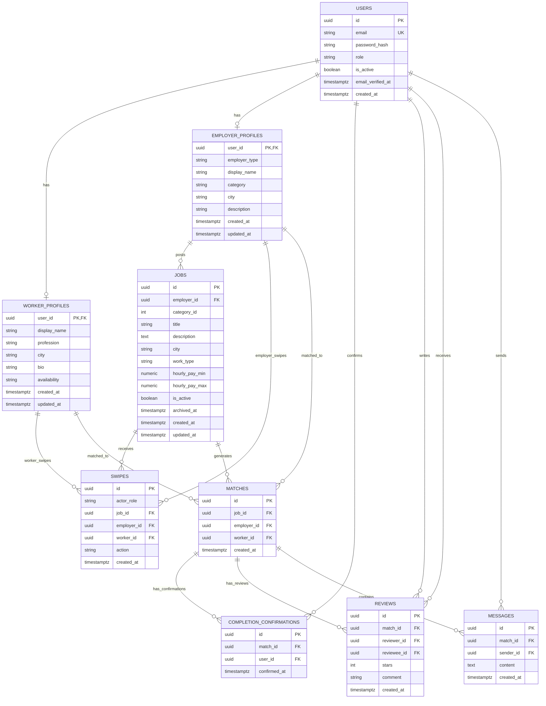

# DoppleJa V1 — Entity–Relationship Diagram (ERD)

**Project:** [javahedi/DoppleJa_V1](https://github.com/javahedi/DoppleJa_V1)
**Audience:** DoppleJa collaborators
**Maintainer and final merge decision-maker:** Repository owner (`javahedi`)

This document provides a practical ERD for the current DoppleJa data model, focused on the core application entities used by authentication, profiles, jobs, swipes, matches, chat, job completion, and two-sided star reviews.

> Important: This ERD is intended as a developer reference. The source of truth for schema creation remains:
> 1. SQLAlchemy models in `backend/app/models/`
> 2. Alembic migrations in `backend/alembic/versions/`
> 3. The live PostgreSQL schema

---

## 1) Core ERD (Mermaid)

You can render this directly in GitHub Markdown.



---

## 2) Relationship explanation

### `users`
The central identity table. Every authenticated account exists here first.

- A user has exactly one role: usually `worker` or `employer`.
- Email verification is tracked with `email_verified_at`.
- Worker and employer domain data are stored in separate profile tables.

### `worker_profiles`
One-to-one with `users` for worker accounts.

- Stores worker-facing information such as display name, profession, city, bio, and availability.
- A worker can swipe on many jobs.
- A worker can participate in many matches.

### `employer_profiles`
One-to-one with `users` for employer accounts.

- Supports both private and business-style employers.
- Stores employer identity shown in the app.
- An employer can create many jobs.

### `jobs`
Represents a single job posting.

- Each job belongs to one employer.
- Jobs are shown in worker discovery.
- Jobs can be active, paused, reactivated, or archived.

### `swipes`
Stores Like/Pass actions from both sides.

- Workers swipe on jobs.
- Employers swipe on workers for a selected job.
- A mutual positive Like from both sides leads to a match.

### `matches`
Created only after both sides Like each other.

- Connects one worker and one employer around one specific job.
- Unlocks private chat.

### `completion_confirmations`
Records each participant's independent confirmation of work completion for a match.

- References `matches.id` through `match_id`.
- References `users.id` through `user_id`.
- Unique constraint: (`match_id`, `user_id`) prevents duplicate confirmations by the same participant.
- Completion is considered mutually confirmed when both matched participants have confirmed.

### `reviews`
Stores the one-to-five-star feedback submitted after both participants confirm job completion.

- References `matches.id` through `match_id`.
- `reviewer_id` identifies the user writing the review; `reviewee_id` identifies the user receiving it.
- Unique constraint: (`match_id`, `reviewer_id`) prevents multiple reviews by the same person for one match.
- Database checks enforce `stars` from 1 to 5 and prevent self-reviews.
- `comment` is optional, up to 1000 characters.
- Public reputation is calculated from **received** reviews, including the count; it is not an independent stored score in either profile table.

### `messages`
Stores chat messages inside a match.

- Every message belongs to one match.
- Every message has exactly one sender.

---

## 3) Simplified flow

```text
users
 ├── worker_profiles
 └── employer_profiles
        └── jobs

worker likes job ──┐
                   ├──> swipes
employer likes worker ┘

if both liked:
    swipes -> matches -> messages
                   |
                   +-> completion_confirmations (worker + employer)
                               |
                               +-> reviews (1–5 stars, both directions)
```

---

## 4) Suggested table-by-table mental model

| Table | Main purpose | Key links |
|------|--------------|-----------|
| `users` | Authentication / identity | parent of worker/employer profiles |
| `worker_profiles` | Worker-facing profile data | belongs to `users` |
| `employer_profiles` | Employer-facing profile data | belongs to `users` |
| `jobs` | Published jobs | belongs to employer |
| `swipes` | Like/Pass actions | links worker, employer, and job |
| `matches` | Mutual Yes | links worker, employer, and job |
| `messages` | Chat after matching | belongs to a match |
| `completion_confirmations` | Each side confirms the job finished | references `matches` and `users` |
| `reviews` | Feedback and 1–5 stars | references match, reviewer, and reviewee |

---

## 5) Important design notes for collaborators

1. **Do not edit the database manually** unless it is for inspection or a controlled local fix.
2. **Schema changes must be implemented via SQLAlchemy models + Alembic migration.**
3. **Never push real user data to GitHub.**
4. **Demo data should be created only through `scripts/seed_demo.py`.**
5. **All changes to database structure require PR review and final approval by the repository owner.**

---

## 6) How to inspect the live database locally

List tables:

```bash
docker compose exec db sh -lc \
  'psql -U "$POSTGRES_USER" -d doppleja_v1_demo -c "\\dt"'
```

Inspect a table:

```bash
docker compose exec db sh -lc \
  'psql -U "$POSTGRES_USER" -d doppleja_v1_demo -c "\\d+ users"'
```

```bash
docker compose exec db sh -lc \
  'psql -U "$POSTGRES_USER" -d doppleja_v1_demo -c "\\d+ jobs"'
```

Export schema only:

```bash
docker compose exec -T db sh -lc \
  'pg_dump -U "$POSTGRES_USER" -d doppleja_v1_demo --schema-only --no-owner --no-privileges' \
  > docs/database/schema.sql
```

---

## 7) Phase 5.4 database constraints and public ratings

The new Phase 5.4 tables and constraints above were checked against:

- `backend/app/models/completion.py`
- `backend/app/models/review.py`
- `backend/alembic/versions/8f24c5d63a10_completion_reviews.py`

**Example:** If a worker has received ratings of 5, 5, 4, 5 and 3 from completed jobs, the public profile should show **4.4 / 5 (5 Bewertungen)**. A worker/employer with no received reviews should display **Noch keine Bewertungen**. Review counts should count review rows, not the number of matched jobs or reviews written by that user.

**Important:** This document is a combined functional/core-entity ERD, not a full introspected dump of every column and supporting database table. The Phase 5.4 table names, constraints, and links are verified against source files provided for the implementation; compare with live PostgreSQL after migrations for a definitive physical schema.

## 8) Recommended next improvement

If you want a **more exact ERD from the live database**, the next step is to generate one from the actual PostgreSQL schema or from your SQLAlchemy models. That can later be exported as SVG/PNG for your team documentation.
